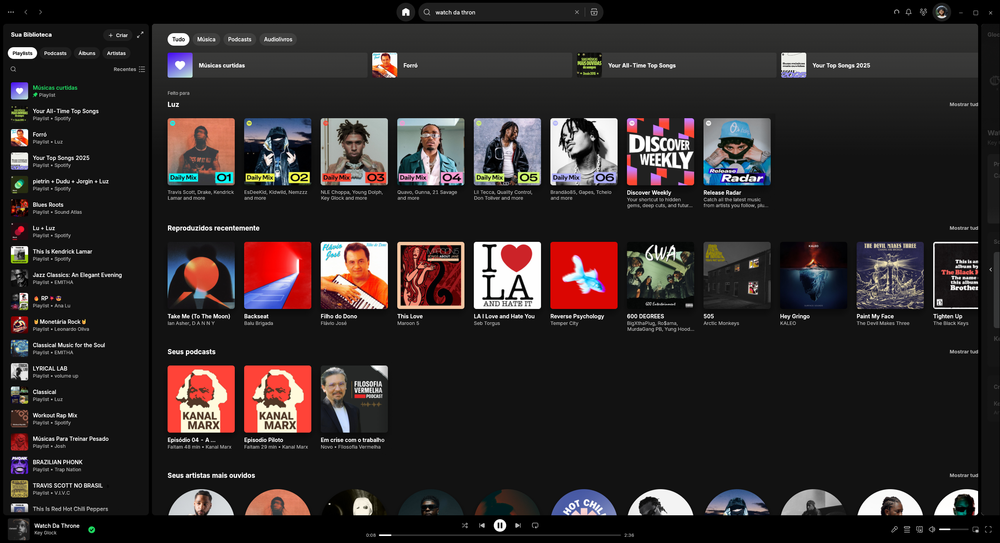

# LiterallySpotify — Spotifast Mod

A Spotify-inspired desktop interface built on [Spotifast](https://github.com/crmne/spotifast). The familiar library, Home, search, player and Now Playing layout run in Spotifast's native Rust application.

[Download for Windows](https://github.com/GUHPY/LiterallySpotify-Spotifast-Mod/releases/latest) · [Visual comparison](docs/UI_COMPARISON.md) · [All features](docs/FEATURES.md) · [Engine updates](docs/ENGINE_UPDATES.md)



## The interface

Home uses artwork colours, playlist shortcuts and horizontal shelves. A persistent top bar holds navigation, search, notifications and the profile menu. The library and Now Playing panels frame the content, and playback controls stay at the bottom.

Search suggestions appear inside the top-bar dropdown while the current page stays visible. Enter opens the full results view. Recent selections keep their artwork and media identity across restarts. A result's cover supports play and pause, with a dark overlay, row highlight and a short elastic press-and-release animation.

Now Playing brings together artwork, expandable lyrics, artist information, available credits and the next queued item. The collapsed panel reveals its own content on hover over the content edge. Lyrics also have a dedicated view with track actions and window controls.

The [visual tour](docs/UI_COMPARISON.md) presents the final interface alongside original Spotifast and Spotify references. It covers the library, collections, artists, search, queue, devices, lyrics, menus, settings and inherited mini-player tools.

## Install

The first release targets **Windows x64**. Choose an asset from [Releases](https://github.com/GUHPY/LiterallySpotify-Spotifast-Mod/releases/latest):

| Asset | Use |
| --- | --- |
| `literallyspotify-v0.1.0-x86_64-pc-windows-msvc-setup.exe` | Install or update the Windows app and its Start menu shortcut. |
| `literallyspotify-v0.1.0-x86_64-pc-windows-msvc.zip` | Extract the whole folder and run `Spotify.exe`. Keep `literallyspotify-portable.txt` beside it. |
| `checksums.txt` and `checksums.txt.sig` | SHA-256 checksums and the Ed25519 signature verified by the app updater. |

The installed executable is **Spotify.exe**, with the Windows shortcut named **Spotify**. The installer uses `%LOCALAPPDATA%\Programs\Spotify`, updating the existing custom installation at that path. The Microsoft Store Spotify package has a different location.

Sign in through the application's normal login flow. No account, token, private signing key or personal profile is included in the downloads. Spotify's account and playback requirements still apply; see the inherited [connection guide](docs/_reference/how-it-connects.md) and [capability limits](docs/_reference/what-spotify-allows.md).

## Updates that preserve the interface

The app's updater reads **this repository's releases** and requires this fork's signature. It does not install upstream Spotifast binaries over the mod.

Engine maintenance is a separate process: an allowlist imports playback, authentication, API and device code while protecting UI files, UI dependencies, icons, packaging and updater identity. Changes are integrated on a review branch and checked before a new LiterallySpotify release is built. An upstream API conflict can require a manual adaptation.

This is one native executable. Engine updates rebuild the app; they are not a hot-swapped plugin. See [Engine updates](docs/ENGINE_UPDATES.md) for the exact boundary and commands.

## What remains from Spotifast

The mod retains library browsing, playback, Spotify Connect controls, queue, podcasts, themes, keyboard and media controls, the Winamp-style mini player, equalizer and visualizer integration. The [feature inventory](docs/FEATURES.md) distinguishes redesigned views, inherited capabilities and service limitations.

## Build

Use the repository's Rust toolchain:

```powershell
cargo build --release --locked --bin Spotify -j 1
```

The result is `target/release/Spotify.exe`. Build with `--features demo` and run with `--demo` for an offline UI demonstration using sample data.

Maintainer checks:

```powershell
python -m pip install -r packaging/requirements-release.txt
python -m unittest discover -s packaging -p test_maintenance.py
cargo check --locked --all-targets
python packaging/verify-ui.py
```

See [CONTRIBUTING.md](CONTRIBUTING.md), [maintenance](docs/ENGINE_UPDATES.md) and the inherited [technical documentation](docs/_reference/).

## Credits and licence

LiterallySpotify is an independent community mod of **Spotifast**, created by [Carmine Paolino and contributors](https://github.com/crmne/spotifast). The native client, playback integration and much of the functionality come from that project. This repository preserves its [MIT licence](LICENSE) and upstream Git history.

Spotify is the visual reference and music service. This project is not affiliated with or endorsed by Spotify AB. Product names, artwork and third-party material shown in screenshots belong to their respective owners.
